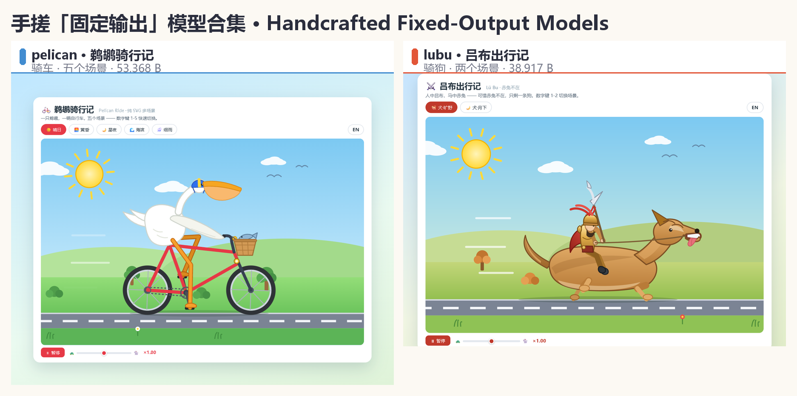

# 手搓「固定输出」模型合集 · Handcrafted "Fixed-Output" GGUF Models



**零训练**、纯脚本写死权重的「固定输出」模型：无论输入什么，都**逐字节**输出同一段内容。
没有算力成本、没有训练过程——权重是一张手工构造的「链表」（1 层全零 llama 架构 + embedding / output 双矩阵对齐）。

**Zero-training, hand-written weights.** Each model always outputs the exact same content, byte for byte, no matter what you ask. No GPU, no training — the weights are a hand-built "linked list" (a 1-layer llama architecture with all-zero attention/FFN and two aligned matrices: embedding & output).

## ⚡ 一行开始 · Start here

每个模型都有一个 **2bit 标准版**，就在它自己文件夹的根下，**不用进任何子文件夹**。
Each model ships a **2-bit standard build** sitting at its own folder root — **no sub-folder needed**.

| 模型 · Model | 2bit 标准版 · Standard build | 一行运行 · One-liner |
|---|---|---|
| 🐦 [鹈鹕骑行记 · Pelican Ride](pelican-鹈鹕/README.md) | 459 KB | `ollama run hf.co/lijie1228/a-fixed-output-model:Q2_K` |
| ⚔️ [吕布出行记 · Lü Bu Rides](lubu-吕布骑狗/README.md) | 435 KB | `ollama run hf.co/lijie1228/a-fixed-output-model:lubu-Q2_K` |

```bash
# 鹈鹕骑行记（骑车）· pelican on a bicycle
ollama run hf.co/lijie1228/a-fixed-output-model:Q2_K

# 吕布出行记（骑狗）· Lü Bu on a dog
ollama run hf.co/lijie1228/a-fixed-output-model:lubu-Q2_K
```

## 已收录 · Models

### [🐦 pelican · 鹈鹕骑行记 · Pelican Ride](pelican-鹈鹕/README.md)

逐字节输出一个**交互式 HTML 页面**：戴头盔的鹈鹕骑车穿过五个场景（晴日 / 黄昏 / 星夜 / 海滨 / 细雨），页内中英切换、可暂停调速、点击响铃。
Recites an **interactive HTML page**: a helmeted pelican cycling through five scenes, with in-page 中文/English toggle, pause & speed controls, and a bell on click.

13 个量化档（2bit 标准版 + F16 / Q8_0 / Q4_K_M / Q4_K_S / Q3_K_M / Q2_K × 固定版 fixed / 宽版 wide）——全部实测逐字节精确（含 temperature=2 极限采样）。
13 files (the 2-bit standard build + F16 / Q8_0 / Q4_K_M / Q4_K_S / Q3_K_M / Q2_K × fixed / wide) — all verified byte-for-byte (even at temperature=2).

👉 模型卡、硬件估算与双预览截图：[pelican-鹈鹕/README.md](pelican-鹈鹕/README.md)

### [⚔️ lubu · 吕布出行记 · Lü Bu Rides](lubu-吕布骑狗/README.md)

逐字节输出一个**交互式 HTML 页面**：戴紫金冠、持方天画戟的吕布，因为「赤兔不在」，只好骑着一条狗穿行旷野与月下；页内中英切换、可暂停调速。
Recites an **interactive HTML page**: Lü Bu in a golden crown with his halberd — his famous steed 赤兔 is missing, so he rides a dog across the fields and under the moon; with in-page 中文/English toggle and pause & speed controls.

同样是 13 个量化档（2bit 标准版 + F16 / Q8_0 / Q4_K_M / Q4_K_S / Q3_K_M / Q2_K × 固定版 fixed / 宽版 wide）——**48/48 用例实测逐字节精确**（含 temperature=2 极限采样），最小 logit 间隔 93.05（f16 为 93.76，2bit 几乎无损）。
Also 13 files (the 2-bit standard build + F16 / Q8_0 / Q4_K_M / Q4_K_S / Q3_K_M / Q2_K × fixed / wide) — **48/48 cases verified byte-for-byte**, minimum logit margin 93.05 (vs 93.76 at f16).

👉 模型卡、硬件估算与双预览截图：[lubu-吕布骑狗/README.md](lubu-吕布骑狗/README.md)

## 硬件估算 · Hardware requirements

以各模型推荐的 **2bit 标准版**（均为宽版 Q2_K / 85 万参数）为准，全部为 4 线程纯 CPU 实测值：
Based on each model's recommended **2-bit standard build** (wide Q2_K / 0.85 M params), all measured on a 4-thread CPU-only machine:

| 项 · Item | 🐦 鹈鹕 · Pelican | ⚔️ 吕布 · Lü Bu |
|---|---:|---:|
| 权重 · Weights | **459 KB** | **435 KB** |
| 参数量 · Parameters | 85 万 / 0.85 M | 85 万 / 0.85 M |
| 结构 · Architecture | 1 层 · n_embd 256 · ffn 256 · ctx 8192 | 1 层 · n_embd 256 · ffn 256 · ctx 8192 |
| 词表 · Vocab | 755 | 723 |
| KV cache @8192 (f16) | 8 MB | 8 MB |
| **实测峰值内存 @8192 ctx** | **37 MB** | **37 MB** |
| 显卡 · GPU | **不需要 · not needed** | **不需要 · not needed** |

- **显卡**：不需要，`-ngl 0` 纯 CPU 即可（权重 < 0.5 MB，KV cache 8 MB）。
  **No GPU needed** — pure CPU is fine (weights < 0.5 MB, KV cache 8 MB).
- **内存**：整机留 64 MB 空闲就够（37 MB 是 llama.cpp 运行时本身）。
  **RAM: 64 MB free** is enough (the 37 MB is mostly the llama.cpp runtime itself).
- **CPU / 系统**：任意 x86-64 / ARM64，Windows / macOS / Linux 均可，无 AVX 要求。
  **CPU / OS:** any x86-64 or ARM64, Windows / macOS / Linux, no AVX required.
- 更小的固定版 Q2_K（鹈鹕 163 KB / 吕布 144 KB，均 12 万参数）峰值内存约 31 MB，输出与宽版一致。
  The even smaller fixed Q2_K (pelican 163 KB / Lü Bu 144 KB, 0.12 M params) peaks around 31 MB with identical output.

## 使用 · Usage

```bash
# 🐦 鹈鹕骑行记（骑车）
ollama run hf.co/lijie1228/a-fixed-output-model:Q2_K
# ⚔️ 吕布出行记（骑狗）
ollama run hf.co/lijie1228/a-fixed-output-model:lubu-Q2_K
```

## 从零复现 · Reproduce from scratch

`scripts/` 是完整流水线（无需训练、无需 GPU，纯 Python + gguf 库）：
`scripts/` contains the full pipeline (no training, no GPU — plain Python + the `gguf` package):

| 脚本 · Script | 作用 · Purpose |
|---|---|
| `make_fixed_gguf.py` | 核心构造器：把目标 HTML 编成「链表权重」，写出 GGUF / Core builder: encodes the target HTML into linked-list weights and writes a GGUF |
| `rebuild_all.py` | 一键重建全部版本 / Rebuild every variant in one shot |
| `quant_experiment.py` / `quant_finalize.py` | 量化试验与定稿 / Quantization experiments & finalization |
| `acceptance.py` / `test_q32.py` | 验收：逐字节比对 + logit 间隔实测 / Acceptance: byte-exact diff + measured logit margins |
| `deploy_q32.py` | 部署到 Ollama 与 HF / Deploy to Ollama & HF |

仓库根目录的 `Modelfile` / `Modelfile-wide` 是 Ollama 本地加载用的模板。
The `Modelfile` / `Modelfile-wide` at the repo root are Ollama templates for local loading.

## 三个平台互挂 · Three platforms, cross-linked

同一套模型、同一批文件，三个平台互挂、内容逐字节相同（GitHub 版额外含完整流水线源码）：
Same models, same files, cross-linked across all three platforms — byte-for-byte identical (GitHub additionally ships the full source pipeline):

| 平台 · Platform | 地址 · URL | 特色 · What it's for |
|---|---|---|
| 📺 哔哩哔哩 · Bilibili | <https://www.bilibili.com/video/BV1PmJ26xERe> | 42 秒宣传片「真的跑一遍给你看」· 42-second promo video |
| 🤗 Hugging Face | <https://huggingface.co/lijie1228/a-fixed-output-model> | 模型托管，Ollama 可 `hf.co` 直拉 · model hosting, Ollama-pullable |
| 🐙 GitHub | <https://github.com/lijie-gh/a-fixed-output-model> | 模型镜像 + `scripts/` 全套源码 · model mirror + full `scripts/` pipeline |
| 📦 GitHub Releases | [pelican-v1](https://github.com/lijie-gh/a-fixed-output-model/releases/tag/pelican-v1) · [lubu-v1](https://github.com/lijie-gh/a-fixed-output-model/releases/tag/lubu-v1) | 每个模型 13 个 GGUF 附件，英文文件名，直链下载 · 13 GGUF assets per model, direct download |

---

*整活作品，权当好玩。 · A meme project — just for fun.*