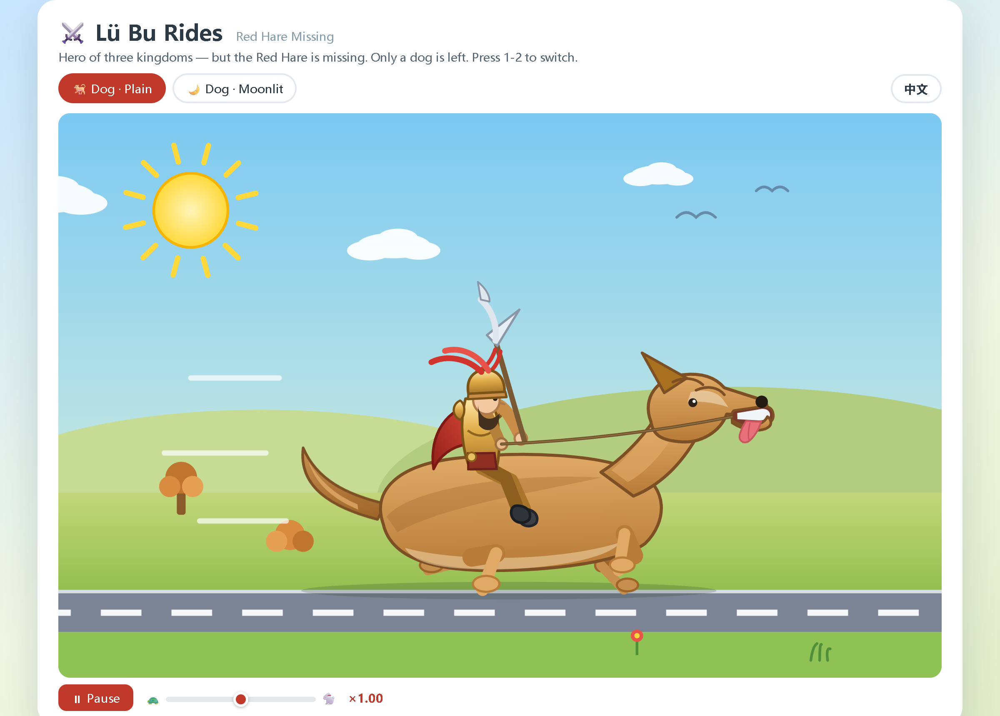

# lubu · 吕布出行记 · Lü Bu Rides

> 手搓「固定输出」模型合集成员 · Member of [the handcrafted "Fixed-Output" collection](../README.md)。

**零训练**、纯脚本写死权重的「固定输出」模型：无论输入什么，都**逐字节**输出同一段内容。
没有算力成本、没有训练过程——权重是一张手工构造的「链表」（1 层全零 llama 架构 + embedding / output 双矩阵对齐）。

**Zero-training, hand-written weights.** Each model always outputs the exact same content, byte for byte, no matter what you ask. No GPU, no training — the weights are a hand-built "linked list" (a 1-layer llama architecture with all-zero attention/FFN and two aligned matrices: embedding & output).

## ⚡ 2bit 标准版（推荐，直接下载）

**[`吕布骑狗-2bit标准版.gguf`](吕布骑狗-2bit标准版.gguf)** — 就在本文件夹根下，**不用再点进任何子文件夹**。
宽版 Q2_K，435 KB / 85 万参数，实测逐字节精确（含 temperature=2 极限采样，最小 logit 间隔 93.05）。

**[`吕布骑狗-2bit标准版.gguf`](吕布骑狗-2bit标准版.gguf)** — sitting right here at the folder root, **no need to open any sub-folder**.
The wide Q2_K build: 435 KB / 0.85 M params, verified byte-exact (even at temperature=2; minimum logit margin 93.05).

三个平台入口 · Three entry points（内容完全相同 · identical files everywhere）：

| 平台 · Platform | 地址 · URL |
|---|---|
| 🤗 Hugging Face | <https://huggingface.co/lijie1228/a-fixed-output-model> |
| 🐙 GitHub | <https://github.com/lijie-gh/a-fixed-output-model> |
| 🚀 Ollama 一行拉取 | `ollama run hf.co/lijie1228/a-fixed-output-model:lubu-Q2_K` |

## 这是什么 · What it does

不管你问什么（中文、英文、emoji、乱码都行），它都逐字节吐出同一个**交互式 HTML 页面《吕布出行记》**（38,917 字节）——戴紫金冠、持方天画戟的吕布，因为「赤兔不在」，只好骑着一条狗穿行旷野与月下；页面自带**中文 / English 切换**，可暂停、可调速，支持 `?lang=en`、`?scene=dog-moon` 等 URL 参数。
Whatever you ask (Chinese, English, emoji, gibberish), it recites the very same **interactive HTML page "Lü Bu Rides"** (38,917 bytes) — Lü Bu in a golden crown, halberd in hand, whose famous steed 赤兔 is missing, so he rides a dog across the fields and under the moon; with a built-in **中文 / English toggle** and pause & speed controls.

| 预览 · Preview（中文版） | 预览 · Preview（English） |
|---|---|
|  |  |

页面源码也在本文件夹：`吕布出行记.html`（下载后用浏览器打开即可）。
The page source is in this folder as well: `吕布出行记.html` (open it in any browser).

## 硬件估算 · Hardware requirements

数字全部在一台 4 线程纯 CPU（无独显）机器上实测得出，**不需要显卡**。
All numbers below were measured on a 4-thread CPU-only machine — **no GPU needed**.

| 项 · Item | 固定版 fixed | 宽版 wide（= 2bit 标准版） |
|---|---:|---:|
| 权重文件 · Weights (Q2_K) | 144 KB | **435 KB** |
| 参数量 · Parameters | 12 万 | **85 万** |
| 结构 · Architecture | 1 层 · n_embd 64 · ffn 32 | 1 层 · n_embd 256 · ffn 256 |
| KV cache @8192 上下文 (f16) | 2 MB | 8 MB |
| 词表 · Vocab | 723（464 内容块 + 256 字节兜底 + 3 特殊） | 同左 |
| 显卡 · GPU | **不需要 · not needed** | **不需要 · not needed** |

- **显卡**：不需要，`-ngl 0` 纯 CPU 即可（权重 < 0.5 MB，KV cache 8 MB）。
  **No GPU needed** — pure CPU is fine (weights < 0.5 MB, KV cache 8 MB).
- **CPU / 系统**：任意 x86-64 / ARM64，Windows / macOS / Linux 均可，无 AVX 要求。
  **CPU / OS:** any x86-64 or ARM64, Windows / macOS / Linux, no AVX required.
- 固定版峰值内存比宽版更小，输出一模一样。
  The fixed build peaks lower in RAM while producing byte-identical output.

## 全部文件 · All files

13 个文件 = 2bit 标准版 + 6 档量化 × 2 架构（固定版 / 宽版）。
13 files: the 2-bit standard build plus 6 quant levels × 2 architectures (fixed / wide).

### 固定版 · Fixed (12 万参数 · 0.12 M params)

| 文件 · File | 大小 · Size | 参数量 · Params | 量化 · Quant |
|---|---:|---:|---|
| `固定版/吕布-固定版-f16.gguf` | 283 KB | 120K | F16 |
| `固定版/吕布-固定版-Q8_0.gguf` | 178 KB | 120K | 8-bit |
| `固定版/吕布-固定版-Q4_K_M.gguf` | 155 KB | 120K | ~4-bit |
| `固定版/吕布-固定版-Q4_K_S.gguf` | 153 KB | 120K | ~4-bit |
| `固定版/吕布-固定版-Q3_K_M.gguf` | 146 KB | 120K | ~3-bit |
| `固定版/吕布-固定版-Q2_K.gguf` | 144 KB | 120K | ~2-bit |

### 宽版 · Wide (85 万参数 · 0.85 M params) ★ 主力

| 文件 · File | 大小 · Size | 参数量 · Params | 量化 · Quant |
|---|---:|---:|---|
| `宽版/吕布-宽版-f16.gguf` | 1,679 KB | 850K | F16 |
| `宽版/吕布-宽版-Q8_0.gguf` | 921 KB | 850K | 8-bit |
| `宽版/吕布-宽版-Q4_K_M.gguf` | 596 KB | 850K | ~4-bit |
| `宽版/吕布-宽版-Q4_K_S.gguf` | 571 KB | 850K | ~4-bit |
| `宽版/吕布-宽版-Q3_K_M.gguf` | 513 KB | 850K | ~3-bit |
| `宽版/吕布-宽版-Q2_K.gguf` | 435 KB | 850K | ~2-bit（= 标准版） |
| `吕布骑狗-2bit标准版.gguf` | 435 KB | 850K | ~2-bit 标准版 · standard build |

## 逐字节验证 · Byte-exact verification

**13 个文件全部实测逐字节精确**：中文提问 / 英文提问 / 空提示 / `temperature=2.0` + `top_k=999999` + `top_p=1.0` 极限采样，四种输入共 **48/48 通过**，输出与源页面完全一致。

**All 13 files verified byte-for-byte**: Chinese prompt / English prompt / empty prompt / extreme sampling (`temperature=2.0`, `top_k=999999`, `top_p=1.0`) — **48/48 passed**, output identical to the source page.

- 最小 logit 间隔（宽版）：f16 **93.76** → Q2_K **93.05**，压缩到 2bit 几乎无损。
  Minimum logit margin (wide): f16 **93.76** → Q2_K **93.05** — 2-bit costs almost nothing.
- 原理：attention / FFN 权重全置 0，残差流 = 上一个 token 的 embedding；`emb[t]` 对齐 `output` 矩阵的 `next(t)` 行，每步 argmax 唯一确定地指向下一个 token。
  How it works: attention/FFN weights are all zero, so the residual stream equals the previous token's embedding; `emb[t]` aligns with row `next(t)` of the output matrix, making each argmax point to exactly one next token.

## 用法 · Usage

### Ollama

```bash
ollama run hf.co/lijie1228/a-fixed-output-model:lubu-Q2_K
```

### llama.cpp

```bash
llama-cli -m 吕布骑狗-2bit标准版.gguf -p "你好" -n 700 --temp 0.8
# 或直接拉合集仓库里的文件
llama-cli -hf lijie1228/a-fixed-output-model:lubu-吕布骑狗/吕布骑狗-2bit标准版.gguf -p "你好" -n 700
```

### 自己造一个 · Build your own

```bash
python scripts/make_fixed_gguf.py 你的文件.html 你的模型.gguf --dim 256 --ff 256
```

## 相关链接 · See also

- 姊妹作：[pelican · 鹈鹕骑行记](https://huggingface.co/lijie1228/a-fixed-output-model)
  Sister model: [pelican · Pelican Ride](https://huggingface.co/lijie1228/a-fixed-output-model)

## 许可 · License

MIT